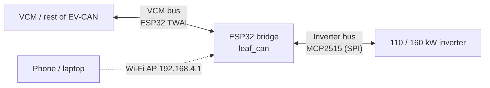

# Esp32LeafInverterBridge

[](https://github.com/Zektopic/Esp32LeafInverterBridge/actions/workflows/ci.yml)
[](LICENSE)

An ESP32-based CAN bridge that lets you fit a **110 kW or 160 kW (EM57, 2018+ "ZE1") inverter** to an
older **Nissan LEAF** or **e-NV200**. The bridge sits between the car's VCM and the inverter on the EV-CAN.
It rescales the torque request, reports the expected torque back to the VCM, and synthesises the messages
the newer inverter expects but an older car never sends. Settings are changed from a phone over Wi-Fi.

It is an ESP32 port of the Muxsan / Dala
[inverter-upgrade CAN bridge](https://github.com/dalathegreat/Nissan-LEAF-Inverter-Upgrade), created because
the original Microchip/STM32 boards were hard to source.

> [!WARNING]
> This device rewrites the torque commands of a high-voltage drivetrain. Incorrect wiring, configuration or
> firmware can cause unexpected acceleration, loss of regenerative braking, fault codes or damage to the
> vehicle. Only install it if you understand the risks, test on a lifted or stationary vehicle first, and
> check local road-legal requirements. The software is provided **without any warranty** (see [LICENSE](LICENSE)).

---

## Contents

- [How it works](#how-it-works)
- [Repository layout](#repository-layout)
- [Hardware](#hardware)
- [Choosing a firmware](#choosing-a-firmware)
- [Building and flashing](#building-and-flashing)
- [Configuration](#configuration)
- [HTTP API](#http-api)
- [Reusing the CAN library](#reusing-the-can-library)
- [Testing](#testing)
- [What changed in 2.0](#what-changed-in-20)
- [Status and limitations](#status-and-limitations)
- [Credits and license](#credits-and-license)

## How it works



Every frame is forwarded transparently in both directions. On the way through:

| Message | Direction | What the bridge does (only in **D**) |
|---|---|---|
| `0x1D4` torque request | VCM → inverter | Positive torque × drive multiplier, regen × regen multiplier, saturated to the 12-bit signal range, CRC-8 recalculated |
| `0x1DA` torque response | inverter → VCM | Replaced by the VCM's original request (so the VCM sees exactly what it asked for), CRC-8 recalculated |
| `0x11A` shifter | VCM | Read: torque is only modified in **D** |
| `0x1F2` charge status | VCM | Read: message emulation pauses while AC charging (would interrupt charging on 62 kWh cars) |
| `0x55B` SOC | VCM | Read: optional "no boost below x % SOC" fuse protection for small packs |

Synthesised towards the inverter, timed from VCM-side messages, to keep the 2018+ inverter free of DTCs
(`P3197`, `P318E`, `U1000`, `U214E`, `U215B`):

| Trigger | Generated frames |
|---|---|
| `0x284` (20 ms) | `0x355` every 40 ms |
| `0x50C` (100 ms) | `0x4B9`, `0x625`, `0x5C5`, `0x3B8` every 100 ms; `0x5EC`, `0x5EB` every 500 ms; `0x5CD` every 1 s |
| `0x603` (wake-up) | `0x605`, `0x607` |
| `0x1F2` (10 ms, off by default) | `0x1C2`, `0x108`, `0x1CB`, `0x1ED`. Keep disabled with a 62 kWh pack |

All of this lives in the hardware-independent [`lib/leaf_can`](lib/leaf_can) library, which both firmwares share.

## Repository layout

```text
.
├── lib/
│   ├── leaf_can/          Reusable EV-CAN library: frame type, IDs, CRC-8, signal codecs,
│   │                      inverter-upgrade state machine, host + differential tests
│   └── bridge_settings/   Web-UI settings model, JSON parser, NVS key map
├── firmware-idf/          ESP-IDF 6.1 firmware (recommended), QEMU end-to-end test
├── firmware/              Arduino-ESP32 firmware (PlatformIO / Arduino IDE)
├── web/                   Configuration page shared by both firmwares
├── hardware/              Schematic
├── docs/specs/            CAN specification slides and the Leaf TX schedule
└── tools/ci_local.sh      Runs every CI job locally in containers
```

## Hardware

- ESP32 module with the on-chip **TWAI** (CAN 2.0) controller plus a 3.3 V CAN transceiver (for example SN65HVD230).
  This connects to the **VCM side** of the EV-CAN.
- **MCP2515** CAN controller with a transceiver (TJA1050 / MCP2551 or similar) on SPI. This connects to the
  **inverter**.
- 12 V → 5 V/3.3 V supply from the vehicle's 12 V system.

Default wiring (changeable in `firmware-idf` menuconfig or `firmware/config.h`):

| Signal | ESP32 GPIO |
|---|---|
| TWAI TX → transceiver TXD | 5 |
| TWAI RX ← transceiver RXD | 4 |
| MCP2515 SCK | 26 |
| MCP2515 SI (MOSI) | 19 |
| MCP2515 SO (MISO) | 18 |
| MCP2515 CS | 15 |
| MCP2515 INT | 22 |
| Status LED | 2 |

The MCP2515 crystal is 8 MHz by default. 16 MHz modules are supported through the menuconfig choice or
`MCP2515_QUARTZ_HZ`. Both buses run at 500 kbit/s. The schematic is in [`hardware/`](hardware); see
[Status and limitations](#status-and-limitations) for what has and has not been verified on the PCB.

## Choosing a firmware

| | `firmware-idf/` (ESP-IDF 6.1) | `firmware/` (Arduino) |
|---|---|---|
| Recommended for | New installs | Existing Arduino users |
| CAN drivers | ESP-IDF TWAI node driver, own MCP2515 driver | ESP-IDF legacy TWAI driver, ACAN2515 |
| Web UI | Embedded in the app image (gzip) | SPIFFS (`pio run -t uploadfs`) |
| Firmware update | `/update`, raw `.bin`, automatic rollback if the new image fails its self test | ElegantOTA at `/update` |
| Tested | Host tests, QEMU end-to-end (web, NVS, OTA, rollback) | Host tests, build only |

Both read and write the same NVS keys as v1.x, so a device keeps its settings when you update or switch
between them. Both use the Arduino `default.csv` partition layout.

## Building and flashing

### ESP-IDF firmware (recommended)

Requires ESP-IDF **v6.1** (or use the official container, as below).

```bash
cd firmware-idf
idf.py menuconfig          # "LEAF inverter bridge": pins, Wi-Fi password, OTA password
                           # "leaf_can": torque multipliers, 0x1F2 emulation, SOC guard
idf.py build
idf.py -p /dev/ttyUSB0 flash monitor
```

Without a local ESP-IDF install:

```bash
docker run --rm -v "$PWD":/project -w /project/firmware-idf espressif/idf:v6.1.1 idf.py build
```

Later updates can be installed from the browser at `http://192.168.4.1/update` with
`firmware-idf/build/leaf_inverter_bridge.bin`. This only works with the car in **P**, and an image that does
not bring both CAN controllers up is rolled back automatically.

### Arduino firmware

**PlatformIO** (recommended for this firmware; library versions are pinned in `platformio.ini`):

```bash
cd firmware
pio run -t upload          # firmware
pio run -t uploadfs        # web UI from ../web into SPIFFS
```

`pio run -e esp32dev` builds against Arduino-ESP32 3.3.12. `-e esp32dev-arduino2` builds against 2.0.17,
the core v1.x was developed on.

**Arduino IDE / arduino-cli**:

1. Install the ESP32 board package (3.3.x) and these libraries: **ACAN2515** 2.1.5, **ESP32Async/AsyncTCP**
   3.5.0, **ESP32Async/ESPAsyncWebServer** 3.12.1, **ElegantOTA** 3.1.7.
2. In `ElegantOTA.h`, set `#define ELEGANTOTA_USE_ASYNC_WEBSERVER 1`.
3. Copy or symlink `lib/leaf_can` and `lib/bridge_settings` into your `Arduino/libraries` folder, or pass them
   to arduino-cli:
   ```bash
   arduino-cli compile --fqbn esp32:esp32:esp32 \
       --library lib/leaf_can --library lib/bridge_settings firmware
   ```
4. Open `firmware/firmware.ino`, set `WIFI_AP_PASSWORD` in `config.h`, build and upload. Upload the
   contents of `web/` to SPIFFS with an ESP32 filesystem uploader.

## Configuration

Connect to the Wi-Fi network **`Can-bridgeINV`** and open **http://192.168.4.1/**.

> [!IMPORTANT]
> The default Wi-Fi password is `Password`, and by default it is also the firmware-update password (user `admin`).
> Change it before installing the bridge in a car: menuconfig → *LEAF inverter bridge → Wi-Fi access point*, or
> `WIFI_AP_PASSWORD` / `OTA_PASSWORD` in `firmware/config.h`. Anyone who knows it can change the torque
> settings.

Settings can only be changed with the car in **P**. Writing flash briefly stalls both CPU cores, and a new
torque map takes effect immediately.

| Setting | Options | Effect today |
|---|---|---|
| Inverter Upgrade | 110 kW, 160 kW, Disabled | **Active.** Selects the drive multiplier; *Disabled* passes torque frames through untouched |
| Vehicle | LEAF 2010–2019, e-NV200, ZE0, AZE0, ZE1 | Stored only |
| Battery | 24 / 30 / 40 / 62 kWh, brute force | Stored only |
| Battery Saver | 50 / 60 / 80 %, off | Stored only |
| Glide in Drive | on / off | Stored only |
| Capacity Boost | on / off | Stored only |
| Current Control | 1–6 kW, unrestricted | Stored only |

"Stored only" settings are kept in NVS for future features. The web page marks them as *not active yet*.

Build-time tuning (`leaf_can` menuconfig or `-D` defines):

| Option | Default | Notes |
|---|---|---|
| Drive multiplier, 110 kW | 0.900 | Value carried over from v1.3.0; it **reduces** torque. Upstream uses 1.32 |
| Drive multiplier, 160 kW | 1.600 | Upstream uses 1.40 (1.4–1.6 suggested) |
| Regen multiplier | 1.100 | |
| 0x1F2 message group | off | Leave off with a 62 kWh pack |
| Minimum SOC for boost | 0 (off) | Upstream used 70 % for 24 kWh packs |

## HTTP API

| Method | Path | Description |
|---|---|---|
| `GET` | `/` | Configuration page |
| `POST` | `/settings` | JSON body, for example `{"Inverter":"160"}`. Replies `200` saved/unchanged, `400` invalid, `409` not in P, `500` flash error |
| `GET` | `/api/status` | Firmware version, gear, torque request/response in Nm, SOC, charge state, per-bus RX/TX/drop/bus-off counters |
| `WS` | `/ws` | Pushes the selected radio-button ids (`Inverter2`, …) on connect and after every change |
| `GET` | `/update` | Firmware update page (HTTP basic auth) |

```console
$ curl -s http://192.168.4.1/api/status
{"firmware":"2.0.0","leaf_can":"2.0.0","uptime_s":42,"inverter_setting":"EM57 motor with 160 kW inverter",
 "shifter":"P","torque_request_vcm_nm":0.00,"torque_request_out_nm":0.00,"torque_response_nm":0.0, ...}
```

## Reusing the CAN library

[`lib/leaf_can`](lib/leaf_can) has no dependency on any CAN controller, RTOS or framework (plain C99, no
heap). It can be used with an MCP2515, ESP32 TWAI, STM32 bxCAN, Linux SocketCAN or a log replayer. It is
packaged as an Arduino library, a PlatformIO library, an ESP-IDF component and a plain CMake target.

```c
#include "leaf_can.h"

static leaf_inverter_t inverter;

static void send(void *ctx, leaf_bus_t bus, const leaf_can_frame_t *frame) {
    my_can_transmit(bus, frame);                  /* your driver */
}

void setup(void) {
    leaf_inverter_config_t cfg;
    leaf_inverter_default_config(&cfg, LEAF_INVERTER_UPGRADE_160KW);
    leaf_inverter_init(&inverter, &cfg);
}

void on_frame(leaf_bus_t from, leaf_can_frame_t *frame) {
    if (leaf_inverter_process(&inverter, from, frame, send, NULL)) {
        my_can_transmit(leaf_bus_other(from), frame);   /* forward after processing */
    }
}
```

The signal helpers can be used on their own, for example in a logger or dashboard:

```c
int16_t request = leaf_can_1d4_get_torque_request(&frame);   /* 0.25 Nm */
uint16_t soc    = leaf_can_55b_get_soc_permille(&frame);     /* 0.1 %   */
bool valid      = leaf_can_frame_crc8_ok(&frame);
```

See [`lib/leaf_can/README.md`](lib/leaf_can/README.md) for the full API and integration snippets.

## Testing

| Suite | What it covers | Command |
|---|---|---|
| `leaf_can` unit tests | CRC-8 against the original table and a bitwise implementation, every signal codec over its full range, torque gating/scaling/saturation, emulation timing and sequences, AC-charge and SOC guards | `cmake -S lib/leaf_can -B build && cmake --build build && ctest --test-dir build` |
| Differential test | Builds the **original v1.3.0 handler** on the host and replays ~1.7 M frames per run of randomised drive traffic through it and through `leaf_can`, comparing every transmitted frame | part of the `leaf_can` ctest run |
| `bridge_settings` tests | Web-form JSON parsing, rejection paths, v1.3.0 NVS key compatibility | `cmake -S lib/bridge_settings -B build-s && cmake --build build-s && ctest --test-dir build-s` |
| QEMU end-to-end | ESP-IDF firmware in Espressif QEMU: boot, NVS, web assets, settings API, WebSocket, auth, OTA update into the second slot, automatic rollback | see `firmware-idf/test/qemu_e2e.py` |
| Firmware builds | ESP-IDF 6.1.1, Arduino-ESP32 3.3.12 and 2.0.17 | |

`tools/ci_local.sh` runs everything above in containers, the same way as
[`.github/workflows/ci.yml`](.github/workflows/ci.yml).

## What changed in 2.0

2.0 extracts the CAN logic into `lib/leaf_can`, adds the ESP-IDF firmware and fixes these problems in v1.3.0:

**Safety**
- **Torque overflow.** Scaling a large request (for example ×1.6 above ~320 Nm) wrapped the 12-bit signal into
  its sign bit, so full throttle could become strong regen. Requests are now saturated.
- **AC-charging guard was dead code.** `charging_state` was never assigned once 0x1F2 generation was turned
  off, so the "don't interrupt AC charging on 62 kWh cars" check never fired. It is read from 0x1F2 again.
- **Half-duplex bridge.** Selecting *e-NV200* in the web UI stopped polling the MCP2515, so inverter → VCM
  traffic stopped while VCM → inverter traffic continued. The bridge no longer depends on the vehicle setting.
- **Settings and OTA while driving.** Both are now refused unless the car is in P.
- **Web parser overflow.** The settings parser wrote into a fixed `String[14]` array without a bounds check,
  so an over-long POST body could crash the bridge. It is replaced by a strict, bounded JSON parser.
- **Unauthenticated OTA.** OTA was open to anyone on the Wi-Fi network. It now requires a password.
- A watchdog reboots the bridge if its main loop or task ever stalls.

**Correctness**
- The VCM-side controller (arduino-CAN) ran the whole CAN handler inside its interrupt and raced the main
  loop on the shared TX buffers, which could lose frames. Frames are now queued and handled in one task. The
  ESP-IDF TWAI driver also removes the "use 1000E3 on ESP32 rev3" bit-rate workaround.
- Translation is direction-aware: 0x1D4 only from the VCM, 0x1DA only from the inverter, and emulation only
  from VCM-side timebases. v1.3.0 could send 0x5CD to the VCM.
- *Inverter: Disabled* now really passes torque frames through. v1.3.0 still re-encoded 0x1D4 and faked
  0x1DA in D.
- Regen scaling is exact. v1.3.0 used one's complement and could be off by 0.25 Nm.
- Removed: the 0x1DB "eco screen" debug code, the commented-out inverter file, the broken config portal,
  vendored library ZIPs and a duplicate schematic.

## Status and limitations

- **Not yet tested in a vehicle.** The 2.0 firmware is verified by the host tests, the differential test
  against v1.3.0, the QEMU end-to-end test and builds. QEMU emulates neither the TWAI controller nor an
  MCP2515, so the two CAN drivers, Wi-Fi and real bus timing still need a bench test with two CAN interfaces
  before driving.
- The 110 kW multiplier of **0.9** is inherited from v1.3.0 and lowers torque. Confirm the intended value
  before use.
- The PCB, its connectors, the 12 V supply and programming through the PCB jumpers have not been verified
  yet (carried over from v1.x).
- e-NV200-specific behaviour and the "stored only" features are not implemented.

## Credits and license

- Original ESP32 port (v1.x): **Adam Saiyad** and **Julius Calzada**
  ([NismoBoy34/Esp32LeafInverterBridge](https://github.com/NismoBoy34/Esp32LeafInverterBridge)).
- CAN strategy and message data: **Dala / Muxsan**,
  [Nissan-LEAF-Inverter-Upgrade](https://github.com/dalathegreat/Nissan-LEAF-Inverter-Upgrade) and
  [Nissan-env200-Battery-Upgrade](https://github.com/dalathegreat/Nissan-env200-Battery-Upgrade).
- Project presentation: [Google Slides](https://docs.google.com/presentation/d/1tVNdFFkDKgH11Tu8PEALcjEXmB1ssmy29CsI_P0dAhI/edit?usp=sharing).

Licensed under the [GNU General Public License v3.0](LICENSE), the license of the upstream firmware this
project is derived from.
