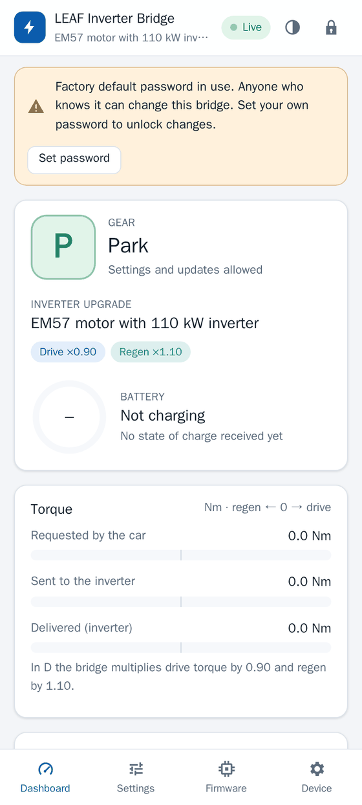
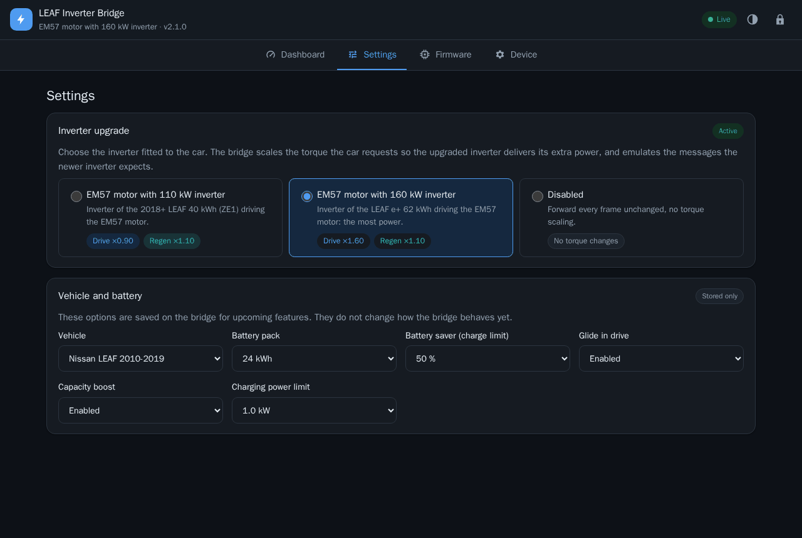
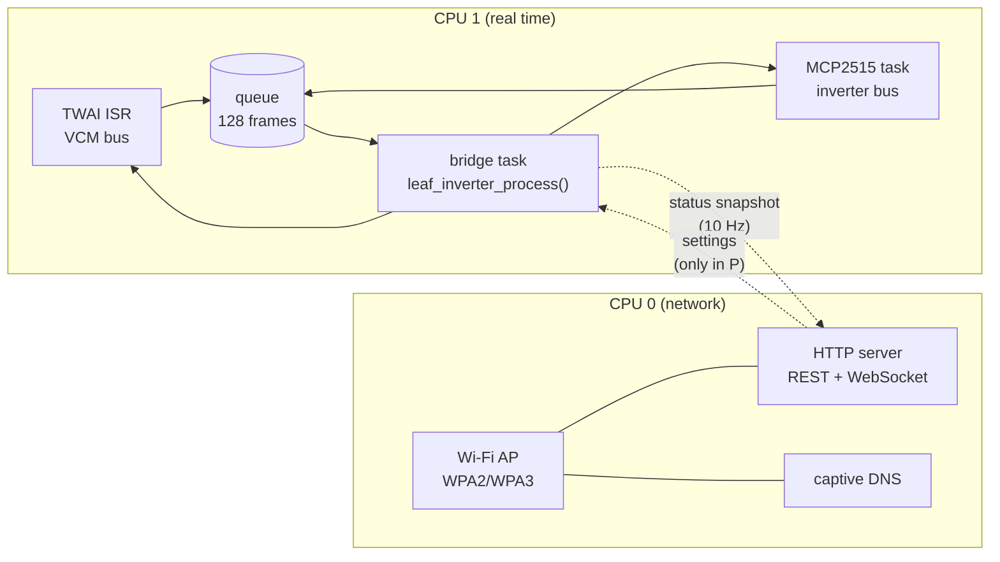

# ESP-IDF firmware

The recommended firmware for the Esp32LeafInverterBridge, built on **ESP-IDF v6.1**. It runs the shared
[`leaf_can`](../lib/leaf_can) library between the car's VCM bus (ESP32 TWAI) and the inverter bus (MCP2515),
and adds a phone-friendly web UI, a REST API, authenticated firmware updates with automatic rollback, and the
diagnostics you need to support a car in the field.

| Dashboard (phone) | Settings (desktop, dark) |
|---|---|
|  |  |

## Contents

- [Features](#features)
- [Architecture](#architecture)
- [Build and flash](#build-and-flash)
- [First-time setup](#first-time-setup)
- [Using the web UI](#using-the-web-ui)
- [Security model](#security-model)
- [REST API](#rest-api)
- [Firmware updates](#firmware-updates)
- [Configuration reference](#configuration-reference)
- [Diagnostics and troubleshooting](#diagnostics-and-troubleshooting)
- [Testing](#testing)

## Features

**Bridge**
- Both CAN buses at 500 kbit/s. The bridge task, the TWAI interrupt and the MCP2515 service task run on
  **CPU 1**; Wi-Fi, lwIP and the web server run on **CPU 0**, so network traffic never delays a CAN frame.
- Measured bridge latency (frame received → handed to the other bus) is reported live as average, 1-second
  maximum and all-time peak, together with frame rates and the TEC/REC error state of both controllers.
- The MCP2515 driver services the chip for as long as its INT line is low, so interrupts cannot be lost. It
  re-initialises a controller that was reset by a supply glitch and keeps retrying one that is missing at boot.
  The bus comes back without restarting the bridge.
- Task watchdog, brown-out detection, stack protection and core dumps to flash.

**Web UI** (`http://192.168.4.1/`)
- Dependency-free single-page app, about 20 KB gzipped. It is embedded in the firmware image, so it needs no
  SPIFFS upload or internet connection.
- Live dashboard: gear, inverter mode and multipliers, state of charge, charging state, torque requested /
  sent / delivered, both bus states, bridge latency and counters. Updates four times a second over a WebSocket.
- Settings, firmware update with progress and reboot tracking, password and Wi-Fi management, system
  information, diagnostics download, restart and factory reset.
- Mobile first, light and dark theme, works inside the phone's captive-portal sheet.
- **Captive portal**: after joining the bridge's Wi-Fi, phones offer to "sign in to the network", which opens the
  page directly.

**Safety**
- Settings, firmware updates, restart and factory reset are refused unless the car is in **P**. A firmware
  update is aborted if the car leaves P while the image is being written.
- An updated image only keeps running if both CAN controllers start; otherwise the bootloader returns to the
  previous firmware on its own.

## Architecture



| File | Purpose |
|---|---|
| `main/bridge.c` | Bridge task, frame queue, latency / rate statistics, settings hand-over |
| `main/can_twai.c` | VCM bus on the ESP32 TWAI node API (TX slot pool, bus-off recovery) |
| `main/mcp2515.c` | Inverter bus: MCP2515 driver with fault recovery |
| `main/security.c` | Admin password (PBKDF2), sessions, login lockout, Wi-Fi credentials |
| `main/web_server.c` | Pages, REST API, WebSocket, OTA, captive-portal redirect |
| `main/captive_dns.c`, `main/dns_reply.c` | Captive-portal DNS server (packet logic host-tested) |
| `main/json_util.c` | Bounded JSON writer / flat-object reader (host-tested) |
| `main/sysinfo.c` | Diagnostics for `/api/system` |
| `main/www/` | The web UI (`index.html`, `app.js`, `app.css`) |

## Build and flash

Requires ESP-IDF **v6.1**, or the official container:

```bash
cd firmware-idf
idf.py menuconfig            # optional: pins, crystal, factory passwords (see below)
idf.py build
idf.py -p /dev/ttyUSB0 flash monitor
```

```bash
# without a local ESP-IDF
docker run --rm -v "$PWD":/project -w /project/firmware-idf espressif/idf:v6.1.1 idf.py build
```

The image is `build/leaf_inverter_bridge.bin` (about 935 KiB; each update slot holds 1.25 MiB). The partition table
matches the Arduino firmware, so a device can move between the two and keep its settings.

## First-time setup

1. Power the bridge. The status LED blinks slowly when both CAN controllers are running, and fast if one is not
   (for example, while no MCP2515 is connected).
2. Join the Wi-Fi network **`Can-bridgeINV`** (password `Password`). Most phones then show *Sign in to network*;
   tap it, or open **http://192.168.4.1/**.
3. The dashboard shows a yellow banner: *Factory default password in use*. Tap **Set password**. Log in with
   `Password` and choose your own admin password (8–64 characters). **Until you do, the bridge refuses every
   change.**
4. Open **Device → Wi-Fi network** and give the access point its own name and password. The phone disconnects;
   rejoin with the new password.
5. With the car in **P**, open **Settings**, choose the inverter fitted to the car, and save.

## Using the web UI

| Page | What it shows / does |
|---|---|
| **Dashboard** | Live gear, inverter mode and multipliers, state of charge, charging state, torque bars (requested by the car → sent to the inverter → delivered), both CAN buses (state, frame rates, error counters, drops, bus-off events), bridge latency and counters |
| **Settings** | Inverter upgrade (active) and the vehicle / battery options that are stored for upcoming features. A save bar appears when something changed; saving needs the admin password and the car in P |
| **Firmware** | Installed version, build, slots; choose or drop a `.bin`, watch the upload, and the page waits for the bridge to restart and confirms the new version (or reports a rollback) |
| **Device** | Admin password, Wi-Fi network, system information (chip, memory, task stacks, reset reason), diagnostics download, crash-dump download / erase, restart, factory reset |

The header shows the connection state (**Live** over WebSocket, **Connected** when falling back to polling,
**Reconnecting**, **Offline**), the theme switch (auto / light / dark) and the login button.

## Security model

| Threat | Mitigation |
|---|---|
| Someone nearby joins the Wi-Fi | WPA2/WPA3 with your own password (changeable in the UI). Joining the network only allows *reading* the status |
| Someone on the Wi-Fi changes the torque map or flashes firmware | Every change needs the **admin password**, which is separate from the Wi-Fi password. While the factory default is in use, changes are blocked entirely |
| Password guessing | 5 wrong passwords lock the login for 30 s, doubling up to 5 min (`429` + `Retry-After`) |
| Stolen flash dump | The admin password is stored as a salted **PBKDF2-HMAC-SHA256** hash (4096 iterations). The Wi-Fi password is stored in plain text, because the Wi-Fi driver needs it |
| Malicious web content | Strict `Content-Security-Policy` (no inline script, no third-party origins), `X-Frame-Options: DENY`, `nosniff`, no CORS |
| Wrong or corrupt firmware | The image header, chip, app descriptor and **project name** are checked before flashing; ESP-IDF then verifies the SHA-256; the new image must pass its CAN self test or it is rolled back |
| Changes while driving | Settings, updates, restart and factory reset are refused unless the shifter is in P |

Sessions are random 128-bit bearer tokens kept in RAM. They expire after 30 minutes idle or 12 hours, and are
cleared by a restart or a password change. The UI stores the token in `sessionStorage`. For more
protection, enable flash encryption and secure boot in menuconfig. Both are one-way eFuse operations: read the
ESP-IDF security guide first.

## REST API

All responses are JSON. Errors look like `{"ok": false, "error": "<code>", "message": "<text>"}`.
Endpoints marked 🔒 need `Authorization: Bearer <token>` (from `/api/login`) or HTTP basic auth with the admin
password (any user name). They answer `403 password_change_required` while the factory password is in use.

| Method | Path | Description |
|---|---|---|
| `GET` | `/api/status` | Live status: gear, inverter mode and multipliers, torque (Nm), battery, bridge counters and latency, both buses |
| `GET` | `/api/settings` | All settings with options, labels, current values and the inverter multipliers |
| `GET` | `/api/session` | `{authenticated, default_password, default_wifi_password}` |
| `GET` | `/api/network` | Access point SSID, channel, client count (never the password) |
| `GET` | `/api/system` | Chip, firmware, OTA slots, memory, task stack headroom, network, crash-dump presence |
| `WS` | `/ws` | `{"type":"status","data":{…}}` 4× per second; `{"type":"settings"}` after a change |
| `POST` | `/api/login` | `{"password"}` → `{"token", "idle_timeout_s", "default_password"}`; `401` wrong, `429` locked |
| `POST` | `/api/logout` | Ends the session |
| `POST` | `/api/password` 🔒 | `{"current", "new"}` → new token (all other sessions are signed out) |
| `POST` | `/api/settings` 🔒 | `{"Inverter": "160", …}`; `409` when not in P |
| `POST` | `/api/network` 🔒 | `{"ssid", "password"}`; applied two seconds later |
| `POST` | `/api/update` 🔒 | Raw `.bin` body (alias `POST /update`); P only |
| `POST` | `/api/reboot` 🔒 | P only |
| `POST` | `/api/factory-reset` 🔒 | Erases settings, passwords and Wi-Fi settings, then restarts; P only |
| `GET` / `DELETE` | `/api/coredump` 🔒 | Download / erase a stored crash dump (`404` if none) |

```console
$ curl -s http://192.168.4.1/api/status | jq '{shifter, inverter: .inverter.label, vcm: .buses.vcm.state}'
{ "shifter": "P", "inverter": "EM57 motor with 160 kW inverter", "vcm": "active" }

$ TOKEN=$(curl -s -X POST http://192.168.4.1/api/login -d '{"password":"my-admin-pass"}' | jq -r .token)
$ curl -s -X POST -H "Authorization: Bearer $TOKEN" http://192.168.4.1/api/settings -d '{"Inverter":"160"}'
{"ok":true,"message":"Settings saved and applied"}
```

## Firmware updates

From the browser: **Firmware → choose `leaf_inverter_bridge.bin` → Install update**. From a script:

```bash
curl -u admin:my-admin-pass --data-binary @build/leaf_inverter_bridge.bin \
     -H "Content-Type: application/octet-stream" http://192.168.4.1/api/update
```

The update is written to the other slot while the current firmware keeps running. After the restart the new
image confirms itself only if both CAN controllers come up (`BRIDGE_SELFTEST_REQUIRE_CAN`). Otherwise the next
reset boots the previous firmware again. Settings, passwords and Wi-Fi settings are kept.

## Configuration reference

`idf.py menuconfig` → **LEAF inverter bridge**:

| Option | Default | Notes |
|---|---|---|
| TWAI TX / RX GPIO | 5 / 4 | VCM bus transceiver |
| MCP2515 SCK / MOSI / MISO / CS / INT | 26 / 19 / 18 / 15 / 22 | Inverter bus |
| MCP2515 SPI clock | 8 MHz | Up to 10 MHz |
| MCP2515 crystal | 8 MHz | 16 MHz modules supported |
| Factory network name / Wi-Fi password | `Can-bridgeINV` / `Password` | Initial values; change them in the UI |
| Wi-Fi channel / max clients | 6 / 2 | |
| Factory admin password | *(empty = Wi-Fi password)* | Must be changed on first login anyway |
| Captive portal | on | DNS server + redirect of connectivity checks |
| OTA self test requires CAN | on | Roll back images that cannot start both controllers |
| Status LED GPIO | 2 | `-1` to disable |

**leaf_can** menu: drive multipliers (110 kW: 0.900, 160 kW: 1.600), regen multiplier (1.100), 0x1F2 message
group (off), minimum SOC for boost (off). See the [library README](../lib/leaf_can/README.md).

## Diagnostics and troubleshooting

| Symptom | What to check |
|---|---|
| LED blinks fast | A CAN controller is not running. *Dashboard → CAN buses* shows which. An MCP2515 that appears later is picked up automatically |
| Bus shows *Warning* / *Error passive* / *Bus-off* | Wiring, termination (120 Ω at each end), transceiver supply, bit rate |
| Inverter bus *Dropped* increases | The inverter does not acknowledge (off, unplugged): frames are aborted after 50 ms |
| Phone does not open the page | Open `http://192.168.4.1/` manually; some phones need mobile data turned off |
| Locked out after wrong passwords | Wait for the lock to expire (max. 5 min), or restart the bridge |
| Forgot the admin password | Reflash with `idf.py erase-flash flash`. This also erases the settings |
| Bridge restarted unexpectedly | *Device → System → Last reset* shows the reason; *Device → Diagnostics* offers the crash dump (`idf.py coredump-info -c <file>`) |

**Device → Diagnostics → Download diagnostics** saves status, settings and system information as JSON (no
passwords) for a bug report.

## Testing

| Test | Command | Covers |
|---|---|---|
| Host unit tests | `cmake -S test/host -B build-host && cmake --build build-host && ctest --test-dir build-host` | JSON helpers and the DNS responder, fuzzed, under ASan/UBSan |
| QEMU end-to-end | `python test/qemu_e2e.py --build build-qemu [--rollback-image …]` | About 100 checks: boot, NVS, assets and headers, auth, forced password change, lockout, settings, WebSocket, Wi-Fi, diagnostics, captive portal, OTA validation / install / rollback, restart, factory reset |
| Browser | `python test/qemu_e2e.py --build build-qemu --serve` + `node test/ui/ui_test.mjs` | The first-run flow in Chromium on a phone and a desktop, including a firmware update through the UI; fails on console errors and CSP violations |

`../tools/ci_local.sh` runs all of them (plus the library tests and the Arduino builds) the way CI does. The
QEMU build replaces Wi-Fi with emulated Ethernet (`sdkconfig.qemu`). QEMU has no TWAI or MCP2515, so the CAN
drivers themselves are verified on real hardware only.
